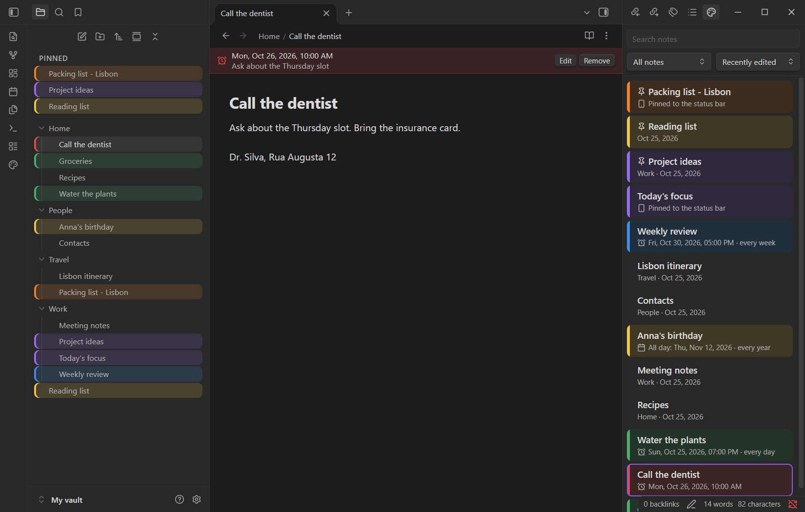
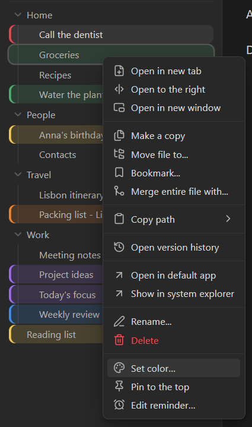
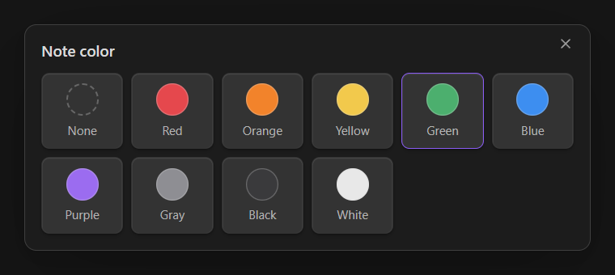
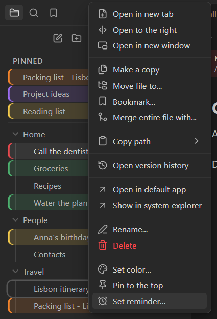
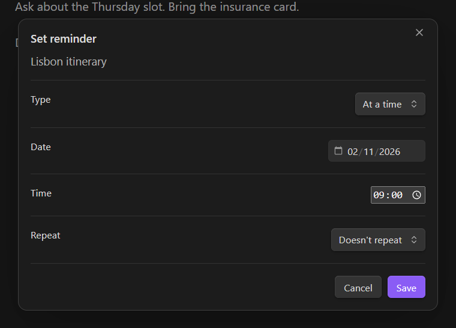
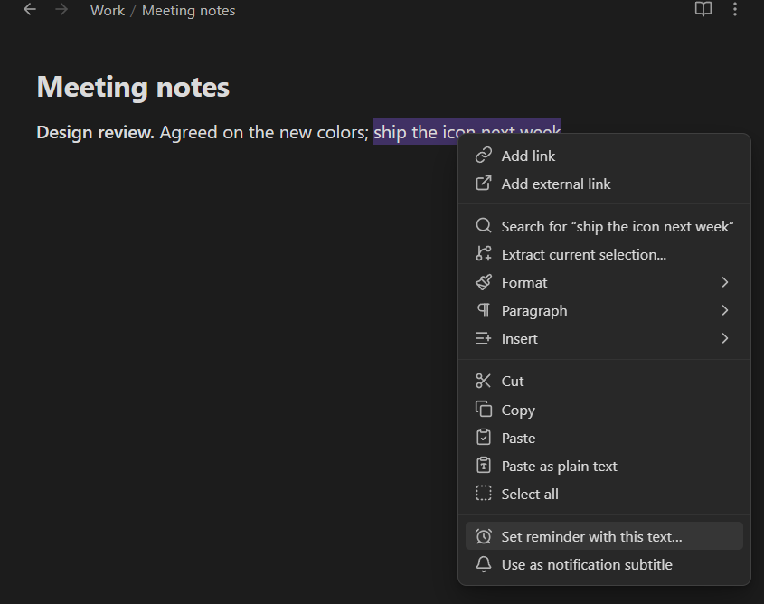
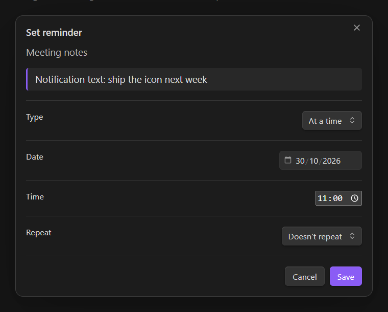
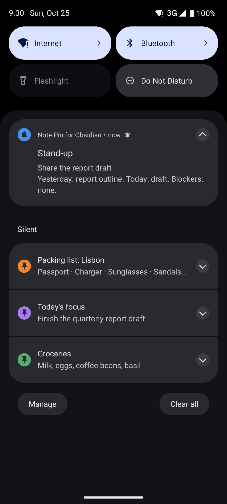
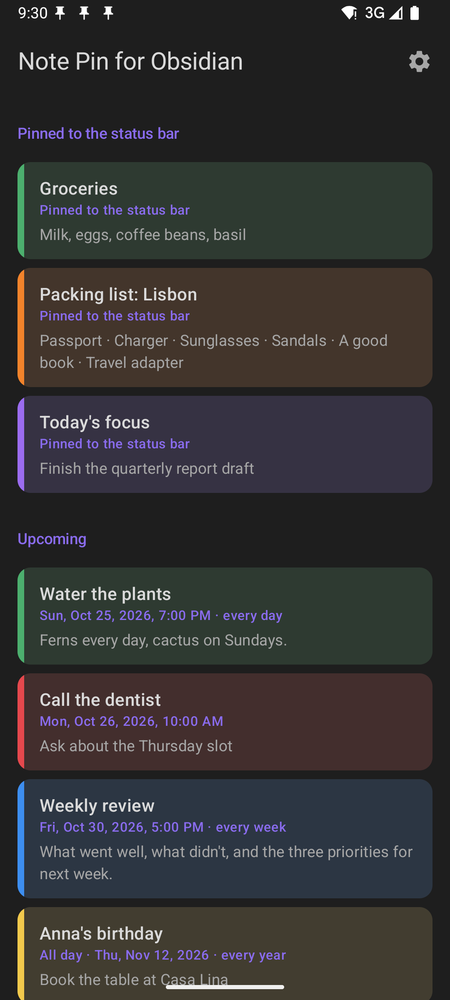

# Note Pin

Color your notes, pin them to the top, and set reminders that repeat. On Android, Note Pin also pins notes to the notification bar, so a shopping list or today's plan stays one swipe away.



## Highlights

- **Pin notes to the Android notification bar.** A pinned note shows its title and first lines, in the note's color, until you unpin it. Tap it and the note opens.
- **Reminders that go off on time:**
  - at a set time, or all day;
  - one-off, or repeating every day, every week or every 2 weeks, every month on a date or a weekday (such as the third Sunday), or every year, also by the Chinese lunar calendar;
  - repeats can stop on an end date;
  - on Android, at the exact minute, even when Obsidian is closed.
- **Note colors:** nine colors or any hex color. They show in the file explorer, the notes list and the notifications.
- **Pin to the top:** your most-used notes get a Pinned section above the folders in the file explorer.
- **Turn selected text into a reminder:** the notification shows the text you selected.
- **Works offline, with no external services:** no account, no server, no analytics. Everything lives in your notes.
- **In English, Russian and Georgian.** It follows Obsidian's language.

Note Pin needs Obsidian 1.10 or later. The Android app needs Android 8 or later.

## Desktop and Android

| | Desktop | Android |
|---|---|---|
| Note colors, the Pinned section and the notes list | ✓ | ✓ |
| Set reminders, with a banner on the note | ✓ | ✓ |
| Reminder notifications | While Obsidian is open. Ones that came due while it was closed show when it starts | At the exact minute, even when Obsidian is closed |
| All-day reminders | A notification at the all-day time | A notification that stays until the end of the day |
| Pin a note to the notification bar | You can set it here; it shows on your phone | ✓ |
| Pins that can't be swiped away | — | ✓ On Android 14 and later, after a one-time ADB command |
| Selected text → reminder | Right-click menu | Commands, which you can add to the mobile toolbar |
| Extra app needed | No | [Note Pin for Obsidian](#on-android-the-note-pin-for-obsidian-app), free |

A reminder you set on one device reaches the others through your vault's sync. On iPhone and iPad there are no notifications, because the companion app is Android-only.

## Works offline, with no external services

- **The plugin makes no network requests.** There's no account, no server and no analytics.
- **The Android app can't go online:** it has no internet permission, so Android itself keeps it offline.
- **Obsidian hands your reminders to the app directly** on the phone, through an Android link. No cloud service sits in between.
- **Everything is stored in your notes' properties,** so it syncs with whatever you already use: Obsidian Sync, Syncthing, iCloud, Git…

## How to use it

### Color a note

Right-click a note in the file explorer, choose **Set color…**, and pick a color.

| Right-click the note | Pick a color |
|---|---|
|  |  |

### Set a reminder

Right-click a note and choose **Set reminder…**. Pick the type, the date and time, and whether it repeats. There are three types:

- **At a time**;
- **All day**: it goes off at the time set for all-day reminders in the plugin settings (09:00 by default). On Android it then stays in the notification bar until midnight;
- **Pin to the status bar (Android)**, which keeps the note in the notification bar instead of reminding you at a set time.

**Repeat** offers these choices, each naming the day it repeats on, such as **Every week on Sunday** or **Every month on the 15th**:

- every day, every week or every 2 weeks;
- every month on the same date;
- every month on the same weekday, such as **Every month on the third Sunday**. If the date is in the last week of its month, there's also **on the last Sunday**. A fifth weekday counts as the last, since most months don't have a fifth;
- every year on the same date;
- every year by the Chinese lunar calendar, for lunar birthdays and festivals. The menu shows the lunar month and day. In a year without that leap month, a leap-month date falls in the regular month of the same number, and day 30 falls on day 29 in a 29-day month. The lunar dates follow the Hong Kong Observatory's tables, for 1901 to 2100.

The weekday and lunar choices take their day from the reminder's date. To stop repeating, set **Repeat until** to the last day the reminder may go off. Leave it empty to repeat forever. Once that day has passed, the banner says **Repeated until** and the date, in grey.

| Right-click the note | Choose when |
|---|---|
|  |  |

A banner at the top of the note shows when the reminder goes off, with **Edit** and **Remove**. Once a one-off reminder's time has passed, the banner stays:

- **Reminder shown** if one of your devices showed it on time;
- **Was due**, in red, if none did. That happens 5 minutes after a reminder's time, or after midnight for an all-day reminder.

### Turn selected text into a reminder

1. Select text in a note.
2. Right-click it and choose **Set reminder with this text…**.
3. Pick when, and save. The notification shows the text you selected.

To change only what the notification says, choose **Use as notification subtitle** instead.

| Right-click the selection | The notification shows that text |
|---|---|
|  |  |

On a phone, long-pressing text opens Android's own menu instead of Obsidian's. Use the **Set reminder with selected text** and **Use selected text as notification subtitle** commands there. You can add them to the mobile toolbar.

### Pin a note to the Android notification bar

Set a reminder and choose **Pin to the status bar (Android)** as the type.

- **On your phone,** the note shows up in the notification bar a few seconds later.
- **On your computer,** it shows up once your vault has synced and you open Obsidian on the phone.

It stays until you remove the pin.

| In the notification bar | In the Note Pin for Obsidian app |
|---|---|
|  |  |

### Pin a note to the top

Right-click a note and choose **Pin to the top**. Choose **Unpin from the top** to undo it.

### The notes list

Click the palette icon in the ribbon to open the **Colored notes** list. Search it, filter it to colored, pinned or reminded notes, and sort it by last edit, title, color or next reminder.

### Commands

Every action is also a command, so you can give it a hotkey or add it to the mobile toolbar:

- Set note color
- Pin or unpin note at the top
- Set or edit reminder
- Remove reminder
- Set reminder with selected text
- Pin or unpin note in the status bar
- Use selected text as notification subtitle
- Open colored notes list
- Send reminders to the companion app (Android only)

## On Android: the Note Pin for Obsidian app

Obsidian plugins can't show notifications on Android, so a small companion app shows them.

<a href="https://play.google.com/store/apps/details?id=com.vladmas.notepinobsidian"></a>
<a href="https://f-droid.org/packages/com.vladmas.notepinobsidian/"></a>

1. Install **Note Pin for Obsidian** from Google Play or F-Droid, or download the APK from [GitHub Releases](https://github.com/ladosha/obsidian_note_pin_android/releases/latest). It needs Android 8 or later.
2. Open it once. Setup asks for permission to show notifications and set exact alarms, and checks that battery use is unrestricted (see [below](#set-battery-use-to-unrestricted)). It also lists anything your phone's maker needs on top, such as Autostart on Xiaomi phones or Never auto sleeping apps on Samsung.
3. Install this plugin in your vault on the phone, and open Obsidian. The first time the plugin sends your reminders, the app asks whether to allow this vault.

After that, the plugin sends your reminders:
- when Obsidian opens;
- when it comes back to the screen;
- when a reminder changes.

Reminders you set on your computer reach the phone once your vault has synced and you open Obsidian there.

### Set battery use to unrestricted

Android, and many phone makers on top of it, can hold back an app whose battery use they restrict. A reminder can then wait until you next open the app instead of going off on time. Setup checks this for you:

1. Open **Note Pin for Obsidian**. Setup opens the first time. After that, it's in **Settings → Setup and permissions**.
2. Look at the **Battery** card. If it has a green check and says "Battery use is unrestricted", you're done.
3. Otherwise, tap the card's button and choose the unrestricted option:
   - **Xiaomi, POCO and Redmi:** **App info** → Battery usage → set Battery saver to **No restrictions**.
   - **Samsung:** **App info** → Battery → **Unrestricted**.
   - **Other phones:** **Battery settings** opens Android's battery optimization list. Show all apps, pick Note Pin for Obsidian, and choose **Don't optimize** (on some phones it's called **Unrestricted**).
4. Come back to the app. The card turns green.

Below it, the **This phone** card lists the settings your phone's maker adds, such as **Autostart** on Xiaomi phones. Turn those on too. If a setting needs your attention later, the app's main screen shows a **Finish setting up** card.

### Notifications that can't be swiped away

Since Android 14, an app can't stop you from swiping away its own notifications. You can allow it once, from a computer with USB debugging turned on:

```
adb shell appops set --uid com.vladmas.notepinobsidian SYSTEM_EXEMPT_FROM_DISMISSIBLE_NOTIFICATIONS allow
```

On the phone itself, you can run the same command with Shizuku or LADB. To check it worked, use the app's **Post test notification** button in Setup.

## Where the data is stored

Note Pin keeps everything in each note's properties (frontmatter), so you can see it, edit it, and use it in Bases or Dataview:

| Property | Example | Meaning |
|---|---|---|
| `color` | `blue` | red, orange, yellow, green, blue, purple, gray, black, white, or a `#rrggbb` color |
| `pinned` | `true` | Pinned to the top of the file explorer |
| `reminder` | `2026-10-27T09:00` or `2026-10-27` | When the reminder is due: a date and time, or a date for all-day reminders |
| `reminder-type` | `time`, `allday` or `statusbar` | The kind of reminder |
| `reminder-repeat` | `daily`, `weekly`, `biweekly`, `monthly`, `monthly-weekday`, `monthly-last-weekday`, `yearly` or `yearly-lunar` | Leave it out for a one-off reminder. `biweekly` is every 2 weeks; `monthly-weekday` is the same weekday each month as on the reminder's date, such as the third Sunday; `monthly-last-weekday` is that weekday's last one each month; `yearly-lunar` is the same day of the Chinese lunar calendar |
| `reminder-until` | `2026-12-31` | The last day a repeating reminder goes off. Leave it out to repeat forever |
| `reminder-shown` | `2026-10-27T09:00` | Added when a device shows a one-off reminder on time, so all your devices know it wasn't missed. It only counts while it matches `reminder` |
| `notification-subtitle` | `Buy milk before 6pm` | What the notification says instead of the note's first line |
| `vmnp-id` | a random ID | Added with the first reminder, so notifications still open the right note after a rename |

## Settings

- **Colors in the file explorer:** a tinted background, colored text, or off.
- **Pinned notes at the top of the file explorer:** on or off.
- **Sort the file explorer by color:** experimental and off by default. It changes Obsidian's file explorer in a way Obsidian doesn't officially support, so an Obsidian update could break it. The notes list always offers sorting by color.
- **Time for all-day reminders.**
- **Show note text in notifications:** turn it off to show only the title and the notification subtitle.
- **Show reminders on this computer** (desktop): set per computer, so you can keep reminders to your phone.
- **Send to the app automatically** (Android).

## Development

```
npm install
npm run build   # builds main.js
npm test        # needs Node 22.18 or later
```

- `src/` holds the TypeScript sources. `npm run build` bundles them into `main.js`, which isn't committed: Obsidian installs it from the release.
- The tests check the repeat rules against `test/data/recurrence-cases.json`, and the Chinese lunar calendar against every month start the Hong Kong Observatory publishes for 1901–2100, in `test/data/chinese-months.json`. The companion app's tests use identical copies of both files, so a change to one belongs in both repositories.
- `scripts/build_lunar_table.py` rebuilds the lunar table in `src/lunar.ts` and `test/data/chinese-months.json` from the Observatory's tables.
- **Releasing:** set the new `version` in `manifest.json` (and `versions.json` if the minimum Obsidian version changes), then push a tag with the same name, for example `git tag -a 1.0.1 -m "1.0.1"` and `git push origin 1.0.1`. The release workflow builds and tests the plugin and makes a draft release with `main.js`, `manifest.json` and `styles.css`. Publish the draft on GitHub.

## Support

Made by [vladmas](https://vladmas.com). If you like this plugin, you can support me on Ko-fi:

<a href="https://ko-fi.com/vladmas"></a>

Note Pin is open source, under the [MIT license](LICENSE).

<sub>Google Play and the Google Play logo are trademarks of Google LLC.</sub>
